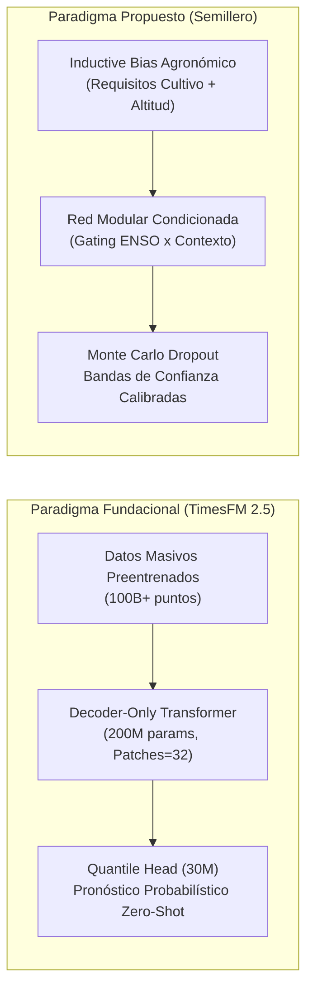

# Estado del Arte: Modelado Predictivo del Impacto Agrícola por Variabilidad Climática y Ciclo ENSO

**Documento Base para Propuesta de Investigación**  
**Proyecto:** *Modelo neuronal de predicción de impacto agrícola por fenómeno del Niño*  
**Semillero de Investigación en Inteligencia Artificial y Agroclimatología**  
**Fecha:** Septiembre 2026  

---

## 1. Introducción y Contexto Epistemológico

La predicción del impacto de la variabilidad hidroclimática sobre los sistemas agrícolas constituye uno de los desafíos más críticos para la seguridad alimentaria y la resiliencia socioeconómica en las regiones tropicales andinas. En Colombia, el ciclo de El Niño-Oscilación del Sur (ENSO, por sus siglas en inglés) representa la principal fuente de variabilidad interanual del clima, alterando los regímenes pluviométricos y térmicos con consecuencias directas sobre la productividad de cultivos transitorios y permanentes.

Históricamente, el modelado del rendimiento agrícola bajo estrés climático ha transitado por cuatro paradigmas computacionales y metodológicos:
1. **Modelos biofísicos de simulación de procesos (Crop Growth Models):** Sistemas como DSSAT, APSIM o WOFOST, basados en ecuaciones diferenciales que simulan la fisiología vegetal, el balance hídrico y el intercambio de nutrientes en el suelo. Aunque mecanísticamente rigurosos, presentan una alta demanda de parámetros edáficos e instrumentales rara vez disponibles con continuidad a nivel municipal en países en desarrollo.
2. **Modelos econométricos y estadísticos clásicos:** Funciones de producción Cobb-Douglas, modelos de regresión lineal múltiple y análisis de series de tiempo autorregresivas (ARIMA, VAR) con variables exógenas. Si bien permiten estimar elasticidades macroeconómicas, son intrínsecamente rígidos para capturar no linealidades extremas, puntos de saturación fisiológica e interacciones espaciotemporales complejas.
3. **Machine Learning y Deep Learning supervisado:** Enfoques basados en datos como Random Forest, Gradient Boosting (XGBoost, LightGBM) y redes neuronales artificiales (MLP, LSTM, Transformers). Han demostrado una capacidad superior para mapear relaciones no lineales de alta dimensión entre clima histórico y rendimiento agrícola.
4. **Modelos Fundacionales de Series de Tiempo (Time-series Foundation Models - TSFMs):** La frontera emergente de la inteligencia artificial generativa (2024–2026), liderada por arquitecturas como **TimesFM (Google Research)**, Chronos (Amazon) y MOIRAI (Salesforce), que emplean modelos transformadores preentrenados a escala masiva para pronóstico *zero-shot* con mínima o nula necesidad de entrenamiento local.

El presente documento analiza críticamente la literatura existente dividida en antecedentes temáticos, examina en profundidad el estudio empírico de Posada & Alfaro (2025), investiga rigurosamente el estado del arte de los Modelos Fundacionales a través de **TimesFM 2.5**, y delimita con precisión el vacío científico que justifica y defiende la propuesta de investigación de este semillero.

---

## 2. Taxonomía y Revisión Crítica de Antecedentes

### 2.1. Grupo 1: Estudios Econométricos y Estadísticos Institucionales en Colombia
Las instituciones gubernamentales y monetarias colombianas han cuantificado históricamente el efecto de El Niño desde una perspectiva agregada:
* **Banco de la República & MinAgricultura:** Investigaciones como las de Romero (2014) y los borradores de economía del Banco de la República sobre choques no lineales entre clima y precios de alimentos cuantifican que eventos severos de El Niño reducen en promedio cerca de un $5\%$ el rendimiento del PIB agropecuario nacional.
* **Limitación metodológica:** Estos estudios emplean modelos econométricos lineales o modelos autorregresivos de transición suave (STAR). Su enfoque es macroeconómico; no modelan la heterogeneidad biofísica a nivel municipal ni incorporan los requisitos ecofisiológicos diferenciados entre cultivos permanentes (café, cacao) y transitorios (maíz, frijol).

### 2.2. Grupo 2: Machine Learning y Deep Learning en Cultivos Colombianos
El trabajo de grado de maestría de **Castro Hernández & Durán Blanco (2023)** en la Universidad Industrial de Santander (UIS) representa el antecedente técnico más cercano en la literatura nacional:
* **Aporte:** Evalúa modelos de aprendizaje supervisado clásico (Regresión Lineal, Random Forest, XGBoost) frente a arquitecturas de Deep Learning (Perceptrón Multicapa - MLP y redes recurrentes Long Short-Term Memory - LSTM) para predecir el rendimiento de café y cacao en el departamento de Santander, utilizando variables meteorológicas locales extraídas de estaciones del Instituto de Hidrología, Meteorología y Estudios Ambientales (IDEAM).
* **Hallazgo:** Los modelos no lineales superaron consistentemente a la regresión lineal, y las redes recurrentes demostraron ventajas al capturar la inercia temporal de cultivos perennes.
* **Limitación crítica / Hueco:** El estudio de la UIS **omite por completo la señal macroclimática explícita de El Niño (índices oceánicos como ONI o anomalías de Temperatura Superficial del Mar - SST)**. El modelo asume que las variables climáticas locales de superficie son suficientes, perdiendo la teleconexión macroclimática y la capacidad de anticipación que brindan los pronósticos oceánicos globales.

### 2.3. Grupo 3: ENSO y Modelado Agrícola en Latinoamérica
A nivel regional, existen antecedentes relevantes pero fragmentados:
* **Perú (Jiménez-Carrión et al., 2018):** Implementaron redes neuronales artificiales en la región de Piura, pero su objetivo fue pronosticar la ocurrencia física del fenómeno de El Niño (anomalías térmicas marinas y vientos), no su traducción en pérdidas o rendimiento de cosechas.
* **Brasil (Stuepp et al., 2022):** Utilizaron Random Forest para evaluar la respuesta del rendimiento de granos (arroz, frijol y soya) frente a diferentes fases del ENSO, evidenciando respuestas asimétricas según la región geográfica y el ciclo del cultivo.

#### Análisis Detallado del Estudio de Posada & Alfaro (2025)
El antecedente más reciente y conceptualmente afín a la integración explícita de ENSO con aprendizaje automático en Centro y Sudamérica es el trabajo de **Posada & Alfaro (2025)**:
> *"Predictive Modeling of El Niño Impacts in El Salvador Using R and Machine Learning Algorithms"*, presentado en la IEEE CONCAPAN XLIII (San Salvador, 2025).

* **Planteamiento:** El Niño-Oscilación del Sur (ENSO) perturba severamente los patrones climáticos en el Corredor Seco centroamericano, reduciendo la producción de maíz debido a sequías intraestivales y lluvias erráticas. El estudio construye un marco reproducible en R para estimar la producción agrícola bajo diversos escenarios ENSO.
* **Integración de Fuentes:** Combina datos históricos de producción y rendimiento agrícola de la Organización de las Naciones Unidas para la Alimentación y la Agricultura (**FAOSTAT/FAO**) con índices e indicadores climáticos de la Administración Nacional Oceánica y Atmosférica (**NOAA**).
* **Modelos Evaluados:** Regresión Lineal Múltiple (MLR), Random Forest (RF) y Extreme Gradient Boosting (**XGBoost**).
* **Resultados Principales:**
  1. XGBoost superó con holgura a Random Forest y a la regresión lineal, registrando el menor error cuadrático medio ($RMSE$) y la mayor capacidad de generalización en años de estrés hídrico.
  2. Confirma empíricamente que los árboles de decisión potenciados por gradiente capturan de forma óptima los umbrales de daño no lineal en cultivos transitorios como el maíz.
* **Contraste con la propuesta de nuestro semillero:**
  * *Puntos de convergencia:* Justifica plenamente la inclusión obligatoria de **XGBoost como el baseline clásico más fuerte** a batir en el semillero, y ratifica la idoneidad de emplear los indicadores oficiales de la NOAA.
  * *Diferencias y oportunidades de avance:*
    * El estudio de Posada & Alfaro es **monocultivo** (únicamente maíz). Nuestro proyecto es **multi-cultivo** (maíz tradicional, maíz tecnificado, frijol, café y cacao).
    * Utiliza agregación a nivel de país (FAO), diluyendo las particularidades microclimáticas. Nuestro proyecto desagrega a nivel municipal (EVA) en tres departamentos clave de Colombia (Huila, Antioquia y Tolima).
    * No implementa arquitecturas de Deep Learning ni mecanismos de modulación agronómica, ni provee cuantificación estocástica de incertidumbre.

### 2.4. Grupo 4: Iniciativas Institucionales Participativas (No-ML)
* **Mesas Técnicas Agroclimáticas (CIAT / CCAFS, 2015):** En el departamento del Cauca y otras regiones de Colombia, se estructuraron espacios de diálogo interinstitucional donde pronósticos de El Niño alimentaban modelos agroclimáticos participativos. Aunque de alto impacto social, estos ejercicios operan mediante recomendaciones agropecuarias cualitativas o modelos de balance hídrico estándar, sin un motor predictivo neuronal automatizado.

---

## 3. Estado del Arte de la Inteligencia Artificial Aplicada a Series Temporales: Investigación Rigurosa sobre TimesFM 2.5

En el marco de la formulación de la propuesta de investigación, es imperativo evaluar la frontera de la inteligencia artificial moderna: los **Modelos Fundacionales de Series Temporales (TSFMs)**, y específicamente **TimesFM 2.5**, desarrollado por **Google Research**.

### 3.1. ¿Qué es TimesFM y cuál es su Principio de Diseño?
**TimesFM (Time Series Foundation Model)** es un modelo transformador preentrenado a gran escala concebido para resolver tareas de pronóstico temporal en modo **zero-shot** (inferencia directa sin reentrenamiento específico para el conjunto de datos de destino).
* Fue entrenado por Google sobre un corpus heterogéneo que supera los **100 mil millones de puntos temporales**, integrando datos sintéticos de procesos estocásticos, series de Google Trends, telemetría de servidores, tráfico web, mediciones de estaciones climáticas y variables macroeconómicas.
* Su filosofía se basa en que los patrones temporales fundamentales (estacionalidad, tendencias, quiebres estructurales, autocorrelación y ruido) comparten regularidades universales que un transformador causal suficientemente grande puede internalizar.

### 3.2. Especificaciones de Arquitectura e Innovaciones en TimesFM 2.5
La evolución desde la primera versión (TimesFM 1.0/2.0) hacia **TimesFM 2.5** introdujo cambios arquitectónicos profundos documentados por el equipo de Google Research:

| Característica Técnica | TimesFM 2.0 | TimesFM 2.5 (Innovación Central) |
| :--- | :--- | :--- |
| **Número de Parámetros** | 500 Millones | **200 Millones** (optimización por destilación y compresión eficiente) |
| **Ventana de Contexto (Context Length)**| 2,048 pasos temporales | **16,384 pasos temporales** ($8\times$ mayor capacidad histórica) |
| **Estructura de Tokenización** | *Patched Decoder* (Parches de 32 pasos) | *Patched Decoder* optimizado con matrices QKV fusionadas |
| **Indicador de Frecuencia** | Obligatorio (requería codificar granularidad) | **Eliminado:** El modelo infiere implícitamente la dinámica multiescala |
| **Pronóstico Probabilístico** | Limitado a cuantiles discretos predefinidos | **Cabezal Cuantil Continuo (30M params opcionales):** Curva de probabilidad continua (P10 a P90) |
| **Tratamiento de Covariables** | Experimental / No nativo | **Soporte extendido vía regresión cruzada (XReg)** para variables exógenas |
| **Adaptabilidad** | Inferencia zero-shot estricta | Soporte para **Fine-tuning eficiente con PEFT / LoRA** vía HuggingFace |

#### Detalle del Mecanismo *Patched-Decoder*
A diferencia de los transformers de lenguaje natural que operan token por token de texto, TimesFM 2.5 agrupa series continuas en **parches contiguos** (típicamente $P = 32$ timesteps). 
1. Cada parche se proyecta a un vector latente denso mediante un perceptrón multicapa de entrada:
   $$\mathbf{e}_i = \text{MLP}(\mathbf{x}_{(i-1)P+1 \,:\, iP})$$
2. La secuencia de parches atraviesa capas apiladas de **atención causal (decoder-only)**, impidiendo que el modelo observe parches futuros (sin fuga temporal).
3. La capa de salida proyecta los estados ocultos hacia un horizonte de predicción que puede configurarse de manera puntual o probabilística mediante la cabeza de pérdida cuantil continua.

### 3.3. Análisis Crítico: TimesFM 2.5 frente al Problema de Rendimiento Agrícola y ENSO
Evaluar TimesFM 2.5 en el contexto de nuestra propuesta de investigación revela profundas fortalezas y limitaciones técnicas:

#### Puntos Fuertes (Ventajas Científicas)
1. **Poder Zero-Shot en Series Climáticas:** TimesFM 2.5 es excepcionalmente hábil modelando las dinámicas oceánicas y atmosféricas continuas (temperatura del mar, series de precipitación mensual del IDEAM e índices ONI/NOAA), ya que el corpus de preentrenamiento contiene ricas señales geofísicas.
2. **Incertidumbre Integrada:** El cabezal cuantil continuo de 30M parámetros resuelve de forma nativa la generación de intervalos de predicción (P10, P50, P90), alineándose con el objetivo de comunicación responsable de riesgos climáticos del semillero.
3. **Punto de Comparación de Vanguardia:** Incluir TimesFM 2.5 como modelo de referencia fundacional elevaría el estándar del artículo científico, comparando no solo contra ML clásico (RF, XGBoost), sino contra la última frontera de Google Research.

#### Limitaciones Críticas para el Dominio Agrícola Específico
1. **Desbalance de Frecuencia Temporal (Anual vs. Parches de 32 pasos):**
   * El reporte oficial de producción agrícola en Colombia (EVA) es estrictamente **anual** ($T = 18$ años, de 2007 a 2024).
   * Dado que TimesFM opera con un tamaño de parche estándar de 32 pasos, una serie agrícola anual municipal completa ($18$ observaciones) **ni siquiera alcanza a llenar un solo parche**. Forzar la serie anual en TimesFM degradaría su capacidad transformadora. Para usarlo, sería obligatorio plantear un esquema jerárquico donde TimesFM procese las series climáticas mensuales ($18 \times 12 = 216$ meses) y un modelo aguas abajo traduzca esto al rendimiento anual.
2. **Falta de Sesgo Inductivo Biofísico (Inductive Bias):**
   * TimesFM es agnóstico al dominio. No "sabe" qué es el estrés hídrico de la floración del café a $1,500$ m.s.n.m., ni distingue la fotosíntesis C3 (cacao/café) de la C4 (maíz).
   * La relación clima-rendimiento no es una mera extrapolación temporal autorregresiva de la cosecha pasada, sino una **función biofísica causal**: el rendimiento es el resultado de la interacción entre la planta, el suelo y la anomalía atmosférica.
3. **Restricción de Recursos Computacionales:**
   * Aunque TimesFM 2.5 redujo sus parámetros a 200M, realizar *fine-tuning* de un modelo de este calibre en GPU de laptop o entornos gratuitos de Colab/Kaggle con variables tabulares exógenas complejas añade una sobrecarga de ingeniería sustancial respecto a una red neuronal modular liviana ($10,000$ a $50,000$ parámetros).

---

## 4. Matriz Comparativa del Estado del Arte

A continuación se sintetiza el panorama de investigación, contrastando los diferentes enfoques frente a la propuesta de este semillero:

| Criterio | Modelos BanRep / MinAgro | Tesis UIS (2023) | Posada & Alfaro (2025) | TimesFM 2.5 (Google Research) | **Propuesta Semillero (Este Proyecto)** |
| :--- | :--- | :--- | :--- | :--- | :--- |
| **Enfoque Algorítmico** | Econometría (Regresión, STAR) | ML (RF, XGBoost) y DL (MLP, LSTM) | ML (RF, XGBoost, Regresión Múltiple) | Foundation Model Transformer (Decoder-only) | **Red Neuronal Modular Condicionada** |
| **Señal ENSO Explícita** | Sí (variable dummy o agregada) | ❌ **No** (solo clima de estación local) | Sí (Índices climáticos NOAA) | No explícita como causa biológica | **Sí (Índice ONI mensual NOAA continuado)** |
| **Clima Local** | No (agregado país) | Sí (estaciones IDEAM Santander) | Sí (NOAA / nacional El Salvador) | Admite covariables exógenas (XReg) | **Sí (Precipitación y Temperatura municipal)** |
| **Alcance de Cultivos** | Macroeconómico (PIB agro) | Café y Cacao (2 permanentes) | Maíz (1 transitorio) | Agnóstico (cualquier serie numérica) | **Multi-cultivo (Café, Cacao, Maíz Tec./Trad., Frijol)** |
| **Resolución Espacial** | Nacional | Departamental (Santander) | Nacional (FAO El Salvador) | No espacializada de forma nativa | **Municipal (Huila, Antioquia y Tolima - EVA)** |
| **Principio de Interacción** | Lineal / Aditivo | Concatenación de features planas | Concatenación tabular en árboles | Atención temporal causal | **Modulación Biofísica (Cultivo $\times$ Zona condiciona ENSO)** |
| **Cuantificación de Incertidumbre** | Errores estándar asintóticos | ❌ No (solo error puntual) | ❌ No (solo métricas $R^2$, $RMSE$) | Sí (Continuous Quantile Head 30M) | **Sí (Monte Carlo Dropout - Bandas 95%)** |
| **Estrategia de Validación** | Muestreo temporal clásico | Split aleatorio $k$-fold | Hold-out temporal estándar | Zero-shot / Rolling Window | **Leave-One-Event-Out (LOEO por evento El Niño)** |

---

## 5. Identificación del Vacío en la Literatura (Research Gap) y Justificación de la Propuesta

A partir de la revisión exhaustiva, se concluye que **existe un vacío metodológico y empírico evidente en la literatura científica nacional y regional**:

> **El Vacío (Research Gap):**  
> Ningún trabajo previo en Colombia combina simultáneamente:
> 1. Una **señal macroclimática global explícita (índice ONI de la NOAA)** acoplada a variables meteorológicas locales.
> 2. Un enfoque **multi-cultivo contrastante** (cultivos permanentes de exportación como café y cacao vs. cultivos transitorios de seguridad alimentaria como maíz y frijol) a escala municipal.
> 3. Una **arquitectura de Deep Learning con principio de modulación biofísica**, donde las características continuas de la planta y de la zona geográfica no se traten como variables simétricas planas, sino como compuertas condicionantes (*gating mechanism*) del impacto de la anomalía climática.
> 4. Una **estrategia de validación estricta por eventos climáticos (Leave-One-Event-Out)** acompañada de **cuantificación probabilística de incertidumbre (Monte Carlo Dropout)**.

### Hipótesis y Justificación del Proyecto
* **Frente a la econometría clásica:** La red neuronal capturará las respuestas no lineales y asimétricas propias del estrés hídrico y térmico en los cultivos.
* **Frente al antecedente más cercano en Colombia (UIS, 2023):** Demostraremos que la incorporación explícita del índice ONI proporciona un horizonte de alerta temprana y un poder explicativo significativamente superior al uso aislado del clima local.
* **Frente a los árboles de gradiente (Posada & Alfaro, 2025):** Mientras que XGBoost sobresale en datos tabulares estáticos, su estructura de partición rectangular ortogonal tiene dificultades para modelar interacciones multiplicativas suaves y carece de una formulación bayesiana natural para incertidumbre. La red neuronal modular propuesta mantendrá la competitividad predictiva de XGBoost incorporando bandas de confianza estocásticas confiables.
* **Frente a los Modelos Fundacionales (TimesFM 2.5):** La red liviana diseñada específicamente para el problema resolverá la limitación de baja frecuencia de los datos agrícolas anuales mediante un fuerte sesgo inductivo agronómico, con un coste computacional cientos de veces inferior y con interpretabilidad causal directa para la toma de decisiones del agricultor.

---

## 6. Referencias Bibliográficas (Formato APA 7.ª Edición)

* Banco de la República. (2018). *Relaciones no lineales entre el fenómeno climático El Niño y los precios de los alimentos en Colombia* (Borradores de Economía N.º 1085). Banco de la República de Colombia. https://www.banrep.gov.co/es/borrador-1085
* Castro Hernández, D. O., & Durán Blanco, E. C. (2023). *Modelo predictivo para el rendimiento de cultivos de cacao y café en el departamento de Santander basado en herramientas de aprendizaje automático profundo y variables climáticas* [Tesis de grado, Universidad Industrial de Santander]. Repositorio Institucional UIS. https://noesis.uis.edu.co/items/956a63ff-267f-48fd-bc2c-083139fb26fd
* Das, A., Kong, W., Sen, R., & Zhou, Y. (2024). *A decoder-only foundation model for time-series forecasting*. arXiv preprint arXiv:2402.02592. Google Research. https://doi.org/10.48550/arXiv.2402.02592
* Gal, Y., & Ghahramani, Z. (2016). Dropout as a Bayesian approximation: Representing model uncertainty in deep learning. *International Conference on Machine Learning (ICML)*, PMLR, 48, 1050–1059.
* Jiménez-Carrión, M., Gutiérrez-Segura, F., & Celi-Pinzón, J. (2018). Modeling and prediction of El Niño in Piura using artificial neural networks. *Información Tecnológica*, 29(4), 303–318. https://doi.org/10.4067/S0718-07642018000400303
* Lobell, D. B., & Field, C. B. (2007). Global scale climate–crop yield relationships and the impacts of recent warming. *Environmental Research Letters*, 2(1), 014002. https://doi.org/10.1088/1748-9326/2/1/014002
* Posada, J., & Alfaro, C. (2025). Predictive Modeling of El Niño Impacts in El Salvador Using R and Machine Learning Algorithms. *2025 IEEE 43rd Central America and Panama Convention (CONCAPAN XLIII)*, San Salvador, El Salvador, pp. 1–6. https://doi.org/10.1109/CONCAPAN66820.2025.11512570
* Romero, J. (2014). El Niño y el sector agropecuario colombiano: Impactos en el rendimiento y precios. *Revista de Economía Agraria y de los Recursos Naturales*, 14(2), 45–68.
* Stuepp, C. A., Heinemann, A. B., & Stone, L. F. (2022). ENSO-driven climate variability and crop yield responses in contrasting Brazilian regions. *International Journal of Biometeorology*, 66(12), 2451–2464. https://doi.org/10.1007/s00484-022-02371-y
